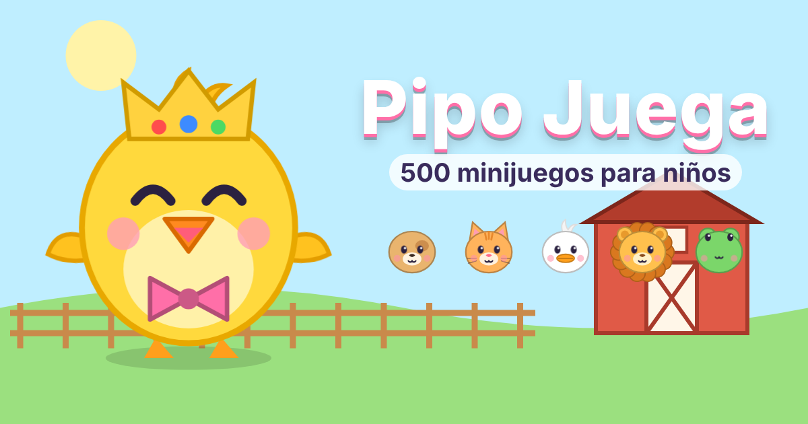

<div align="center">



# 🐥 Pipo Juega

**500 minijuegos educativos y gratuitos para niños pequeños (2 a 7 años).**

Colores, números, letras, animales, emociones, música, formas y hábitos de cuidado. Tiene voz en español e inglés, dibujos propios y animaciones, y no muestra anuncios.


</div>

---

## ✨ Novedades de la versión 2

| | |
|---|---|
| 🎨 **Gráficos** | 21 animalitos originales dibujados en código, con caras que cambian (feliz, triste, sorprendido…). Pipo animado que parpadea y aletea. 13 fondos ilustrados, transición de círculo entre juegos, fuegos artificiales, estrellas que vuelan y ondas al tocar. |
| 🎮 **Juegos** | De 20 a **33 tipos**. Los nuevos son rompecabezas, trazar letras y números, vestir a Pipo, lavar platos y carro, granja musical, laberinto, pesca, jardín, patrones, diferencias, vehículos, ropa según el clima y emociones. |
| 🔊 **Sonido** | Voces de animales sintetizadas y 5 canciones infantiles (Martinillo, Estrellita, Los pollitos, Arroz con leche, Cucú). Los papás pueden **grabar su propia voz** para felicitar, y Pipo dice el nombre del niño. |
| 👧 **Perfiles** | Varios niños en el mismo dispositivo, cada uno con su nombre, edad, color y personaje. La dificultad se ajusta según la edad. Idioma español o inglés. |
| 🗺️ **Motivación** | Mapa de 10 mundos (Granja, Bosque, Mar, Jardín, Ciudad, Dulces, Cocina, Noche, Espacio, Cielo). Álbum de 50 stickers animados, cofre sorpresa cada 25 niveles con accesorios para Pipo y racha de días seguidos 🔥. |
| 👨‍👩‍👧 **Papás** | Candado con una suma, límite de tiempo diario (Pipo se va a dormir), reporte de avance, elegir qué juegos salen, modo noche y modo liviano. |
| ☁️ **Nube (opcional)** | El avance se guarda con un código y se puede pasar a otro dispositivo, usando Supabase. |

## 🎮 Los 33 tipos de minijuegos

Globos · Ordenar frutas · Pop-it · Emociones · Contar · Huevo sorpresa · Rompecabezas · Colorear · Encuentra · Granja musical · Memoria · Dar de comer · Trazar · Cocinar · Unir puntos · Vehículos · Hora del baño · Piano · Laberinto · Grande y pequeño · Dentista · Patrones · Sombras · Piñata · Pescar · Bomberos · Ropa y clima · Túnel del conejo · Jardín · Encaja formas · Diferencias · Lavar · Viste a Pipo

Los 500 niveles se reparten entre los 33 tipos, y cada nivel es distinto: cambian los animales, colores, cantidades y fondos. La dificultad sube poco a poco.

## 📁 Estructura

```
├── index.html            ← la página
├── css/estilos.css       ← colores, tamaños y animaciones
├── js/
│   ├── arte.js           ← dibujos: animales, Pipo, accesorios y fondos
│   ├── motor.js          ← sonidos, voz, guardado, perfiles y ⚙️ CONFIG (Supabase)
│   ├── juegos-clasicos.js← 20 juegos
│   ├── juegos-nuevos.js  ← 13 juegos nuevos
│   └── pantallas.js      ← inicio, mapa, festejos, cofres y panel de papás
├── img/                  ← íconos y vista previa para compartir
├── audio/                ← (opcional) musica.mp3 propia
├── docs/supabase-pipo.sql← (opcional) tabla para guardar en la nube
├── manifest.json · sw.js ← para instalarlo como app y jugar sin internet
```

## 🚀 Publicar

1. Sube todos los archivos y carpetas a un repositorio de GitHub.
2. En [vercel.com](https://vercel.com) elige **Add New → Project**, importa el repositorio y pulsa **Deploy**. No hace falta configurar nada.
3. En `index.html`, cambia `TU-PAGINA` por tu dirección de Vercel en la línea `og:image`. Así se verá la imagen al compartir por WhatsApp.

## ☁️ Guardado en la nube (opcional)

1. Crea un proyecto gratis en [supabase.com](https://supabase.com).
2. Ve a **SQL Editor**, pega el contenido de `docs/supabase-pipo.sql` y pulsa **Run**.
3. En **Project Settings → API**, copia la *Project URL* y la llave *anon public*.
4. Pégalas en `js/motor.js`, al inicio del archivo, en `SUPABASE_URL` y `SUPABASE_KEY`.
5. En el juego, entra en **Papás → Nube → Crear código**. Con ese código se carga el avance en otro dispositivo.

## 🎙️ Grabar tu voz

Entra en **Papás → Tu voz**, pulsa **Grabar** junto a cada frase y habla unos 3 segundos. Pipo usará tu voz para felicitar al niño. La grabación queda solo en ese dispositivo.

## 🔒 Privacidad

No hay anuncios, cuentas ni rastreo. Todo se guarda en el propio dispositivo, salvo que actives la nube.

---

<div align="center">Hecho con cariño por Leandro Zamora 💛</div>
